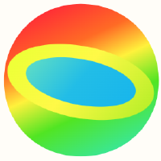

#  eyelight

A small Rust relational reasoner with explanations and independently checked proofs.

**Version 0.1.11**

- Try programs in your browser: [Playground](https://eyereasoner.github.io/eyelight/playground/).
- Learn how to use eyelight: [Guide](https://eyereasoner.github.io/eyelight/).
- Read the language and proof contract: [Specification](https://eyereasoner.github.io/eyelight/SPEC/).
- Explore runnable programs: [Examples](https://github.com/eyereasoner/eyelight/tree/main/examples/).
